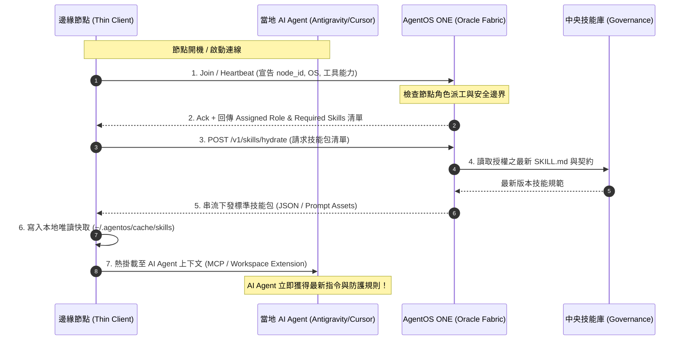

# AgentOS 分散式節點改造與動態技能水合指引 (Node Migration & Dynamic Skills Playbook)

## 📌 核心架構願景

在 AgentOS ONE 架構下：
1. **中央開發機 (Oracle VM)**：唯一保留完整 `agentmanager` 源碼庫，專注於 AgentOS 核心引擎研發、CI/CD 驗證與治理合流。
2. **終端工作節點 (Other Nodes)**：**不 clone `agentmanager` 源碼庫**，僅部署不可變的 **Thin Client / Runtime**。
3. **動態技能水合 (Just-In-Time Skill Hydration)**：節點加入 Realm 後，透過 ONE 協定交握，根據該節點當前被指派的角色（Role）與任務（Goal），由 ONE 動態推播或拉取所需技能（Skills），實現開箱即用與永遠最新。

---

## 🔄 節點動態技能拉取流程 (Dynamic Skills Workflow)



---

## 🛠️ 現有節點改造指南 (Existing Machines Migration Playbook)

目前在 Realm 中已註冊的非 Oracle 機器清單：
- **`mbpr`** (macOS, Alston's MacBook Pro)
- **`VO10005870`** (Windows 工作機)
- **`vopc5750`** (Windows 工作機)
- **`dqa03backup`** (Linux 備份主機)

這些機器原本大多 clone 了整包 `agentmanager`，請依以下步驟進行解耦改造：

---

### 1. Windows 工作節點 (`VO10005870`, `vopc5750`)

#### 步驟 A：處置舊代碼庫
1. 若舊 `agentmanager` 目錄下有未提交的**專案業務代碼**或設定，先備份移出。
2. 停用在 `agentmanager` 目錄下的手動執行腳本。
3. 可直接封存或刪除舊的 `C:\...\agentmanager` 目錄。

#### 步驟 B：切換為官方一鍵 Thin Client
1. 打開 PowerShell（無須 Administrator）：
   ```powershell
   # 執行官方安裝引導（會保留既有 state/client.json 的 Node ID 與 Token）
   irm https://raw.githubusercontent.com/alston-personal/agentmanager/main/install-agentos.ps1 | iex
   ```
2. 安裝完成後，系統會自動建立隱藏式的 `AgentOS Thin Client` 排程任務，背景靜默連線 Oracle ONE，開機自啟。
3. 驗證連線狀態：
   ```powershell
   agentos-client verify
   ```

#### 步驟 C：IDE (Antigravity / Cursor) 設定
- **不要**將整包 `agentmanager` 當作工作區開啟。
- 只開啟您要開發的具體專案（如某個業務代碼倉庫）。
- 在 IDE 的 MCP 配置中，加入 `agentos-one` MCP 連線，所有跨專案上下文與技能將由 Oracle 即時注入。

---

### 2. macOS 工作節點 (`mbpr`)

#### 步驟 A：處置舊代碼庫
1. 確認 `/Users/.../agentmanager` 內無殘留私有未 push 的分支。
2. 歸檔或刪除舊 `agentmanager`，避免 VS Code 或 Spotlight 持續耗能索引。

#### 步驟 B：部署輕量 Thin Client
1. 建立獨立的 Runtime 目錄：
   ```bash
   mkdir -p ~/.agentos/runtime
   # 保留既有的 client.json 節點身分憑證
   # 啟動以 thin_client 模式連線
   python3 -m agentos_node.thin_client --daemon
   ```
2. 可利用 macOS `launchd` 註冊為常駐背景服務（登入自動啟動）。

#### 步驟 C：AI Agent 技能對接
- 本地 Antigravity 或 Claude Code 透過 `agentos-one` MCP 與 Oracle 交握。
- 啟動對話時，ONE PreInvocation Hook 自動按需灌注當前工作所需的 IR 與技能手冊。

---

### 3. Linux 輔助節點 (`dqa03backup`)

#### 步驟 A：切換為 Systemd User Service
1. 舊有的手動 clone 目錄不再進行 `git pull`。
2. 設定 systemd 服務檔 `~/.config/systemd/user/agentos-thin-client.service`：
   ```ini
   [Unit]
   Description=AgentOS Thin Client Node
   After=network.target

   [Service]
   Type=simple
   ExecStart=/usr/bin/python3 -m agentos_node.thin_client --config %h/.config/agentos/client.json
   Restart=always
   RestartSec=10

   [Install]
   WantedBy=default.target
   ```
3. 啟動服務：
   ```bash
   systemctl --user daemon-reload
   systemctl --user enable --now agentos-thin-client.service
   ```

---

## 📋 改造前後對比

| 評估維度 | 舊方式 (Clone agentmanager) | 新方式 (Thin Client + ONE Dynamic Skills) |
| :--- | :--- | :--- |
| **磁碟占用** | 數 GB (含 git history, node_modules) | < 30 MB (僅 Thin Client 與快取) |
| **維護成本** | 每台機器動輒 `git pull` 衝突、10K+ 報錯 | **零維護**，開機自動連線 ONE |
| **技能更新** | 必須手動更新代碼庫才抓得到最新 Skill | **即時生效**，由 ONE 動態串流最新版本 |
| **權限隔離** | 每個節點持有全部代碼與可能敏感的腳本 | **最小權限原則**，僅依 Role 下發必要技能 |

