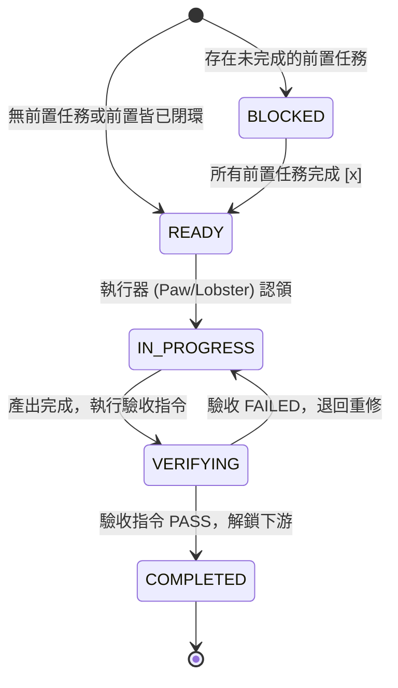

# 🎯 AgentOS 具體任務規格與驗收要件標準 (Task Specification & Acceptance Standard)

> **版本**：1.0  
> **發布日期**：2026-11-04  
> **適用範圍**：`GLOBAL_TODO_LIST.md`、各專案 `STATUS.md`、架構師派單、執行器（The Paw / Lobster）接單。

---

## 🚫 痛點與反模式 (Anti-Patterns to Forbid)
嚴禁在任何待辦清單中出現以下「無從驗收的抽象空話」：
- ❌ 「優化系統效能」
- ❌ 「提升代碼安全性」
- ❌ 「重構底層邏輯」
- ❌ 「研究相關技術」

若任務描述無法回答「**執行什麼命令能證明它完成了？**」，該條目即為不合格，執行器不得領單，架構師必須退回重拆。

---

## ✅ 合格具體任務的五大要件 (The 5 Core Elements)

每個具體任務（Micro-Task）必須滿足以下五項要件，格式可採簡要 Markdown 規格或結構化標註：

### 1. 【目標】明確動作與改動目標 (Specific Action & Target)
- 必須具體指出要修改、建立或修復的模組路徑或功能。
- 例：`實作 trend_digest/collector.py 的 RSS 解析模組，支援 Google News 查詢`。

### 2. 【邊界】範圍限制與防護網 (Scope & Boundaries)
- 限制改動範圍，防止執行器失控或越權破壞其他模組。
- 例：`僅限修改 history-synthesizer/scripts/ 內部採集腳本，不得破壞現有 viewer/ 前端結構`。

### 3. 【依賴】前置條件與任務級相依性 (Task-Level Dependencies)
- **前置任務 ID (depends_on)**：若本任務依賴其他任務產出，必須明記前置任務代號（例：`依賴: task-012` 或 `前置: [collector-abstraction]`）。
- **解鎖阻塞機制 (Blocker Unlocking)**：
  - 前置任務未標記完成 (`[x]`) 前，本任務處於 `BLOCKED` 狀態，執行器**嚴禁搶先執行**。
  - 當前置任務驗收通過結案，下游任務自動解鎖為 `READY`。
- **依賴加權**：若任務 A 阻擋了多個下游任務（`blocks: [task-B, task-C]`），任務 A 的執行優先權自動倍增！

### 4. 【驗收】可執行的驗收指令 (Executable Verification Command)
- **核心關鍵！** 必須給出一行可直接在 shell 執行的命令，並指明預期結果。
- 例：
  - `python3 -m unittest tests.test_collector -v` 預期 exit code 0
  - `curl -sI https://studio.milkcat.org/trends/mio_lifestyle.html | grep "HTTP/1.1 200"`
  - `python3 scripts/synthesize.py --dry-run` 輸出包含 `獲取到即時情報`

### 5. 【產出】交付物與存證 (Deliverables & Receipts)
- 完成後留下的檔案或狀態更新。
- 例：`產生 unit test 通過日誌，並更新 STATUS.md 標記 [x]`。

---

## 🚦 任務狀態機 (Task Lifecycle State Machine)



---

## 📝 待辦清單標準書寫模板 (Todo Checklist Template)

在 `GLOBAL_TODO_LIST.md` 或 `STATUS.md` 中，短格式與詳細格式如下：

### 短格式（單行 Checklist，支援相依性與驗收指令）
```markdown
- [ ] [任務ID] [專案代號] 具體動作與標的 | 前置: [依賴任務ID或none] | 驗收: `具體驗收指令`
```
*範例：*
```markdown
- [ ] [task-col-01] [shared] 將 TrendCollector 抽象為獨立共用套件 | 前置: none | 驗收: `python3 -c "import shared.collector"` 退出碼 0
- [ ] [task-hs-01] [history-synthesizer] 替換 SerpAPI 為共用 Collector | 前置: task-col-01 | 驗收: `python3 scripts/test_collector.py` 輸出含即時資料
```

### 完整結構化格式（適用於跨專案複雜任務 / PR 派工）
```markdown
### 任務：[任務ID] [專案代號] 任務簡述
- **目標**：具體修改檔案與目標行為
- **前置任務 (Depends On)**：task-xxx, task-yyy (若無填 none)
- **解鎖任務 (Blocks)**：task-zzz
- **影響範圍**：目錄或檔案限制
- **驗收命令**：`命令列指令` (預期輸出或退出碼)
- **交付產出**：Commit / Receipt / 文件更新
```
